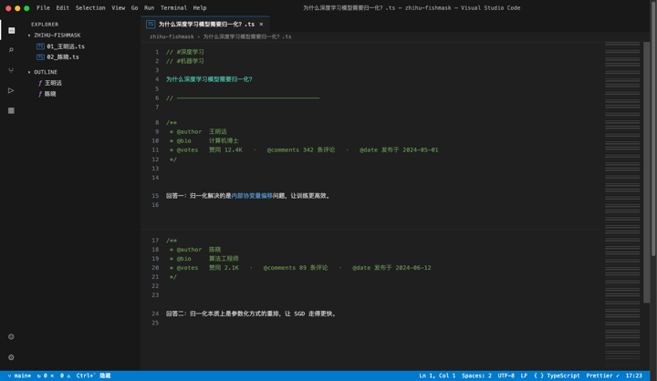

<h1 align="center">🐟Zhihu Fishmask🐟</h1>

<p align="center"></p>

<p align="center">
  
  
  
</p>

把知乎伪装成 **VS Code Dark+ 编辑器**的油猴脚本。问题、回答、专栏文章和首页推荐流都会被重绘成代码编辑器：标题是文件名，回答是带行号的代码，首页信息流则是一条条 `git log` 提交记录。

纯前端渲染层：不改请求、不碰登录态，点赞、评论、关注照常走知乎原生接口。

## 功能

- **问题 / 回答页** —— 问题标题作为文件名，话题渲染成 `// #话题` 注释，回答正文带行号与保守语法高亮，作者信息折叠成 JSDoc 头
- **专栏文章** —— 整篇文章渲染为单个文件，OUTLINE 显示正文章节
- **首页推荐流** —— `topstory-log.ts`，每条推荐伪装成一次 commit：`a3f9c21  feat(作者): 标题`
- **图片悬浮窗** —— 正文图片显示为注释行，点击弹出可拖拽、可缩放的预览窗
- **老板键** —— `Ctrl+\`` 或双击 `Esc` 在伪装与原生知乎之间切换
- **干扰过滤** —— 相似推荐、猜你喜欢、商业推广等板块不渲染进代码区

## 安装

**前置**：浏览器先装好 [Tampermonkey](https://www.tampermonkey.net/) 扩展。没有它，点安装链接只会下载一个文件。

### 方式一：一键安装

[](https://raw.githubusercontent.com/Bkyaro/zhihu-fishmask/main/zhihu-fishmask.user.js)

点击后 Tampermonkey 会弹出脚本安装确认页。

### 方式二：手动粘贴

1. 打开 Tampermonkey 面板 → 新建脚本
2. 把 [`zhihu-fishmask.user.js`](zhihu-fishmask.user.js) 全文粘贴进去 → 保存
3. 打开任意知乎页面，伪装自动生效

脚本通过 `@downloadURL` / `@updateURL` 指向本仓库，之后发新版会自动提示更新；手动检查更新走 Tampermonkey 面板的「检查脚本更新」。

## 使用

| 操作                      | 效果                                                               |
| ------------------------- | ------------------------------------------------------------------ |
| `Ctrl+\`` 或 双击 `Esc`   | 切换伪装 / 原生知乎（**老板键**）                                  |
| 点红绿灯 / 标签页 `×`     | 同上（隐藏伪装）                                                   |
| 滚动到编辑区底部          | 自动触发知乎加载更多回答并追加渲染                                 |
| 点正文链接 / 图片占位行   | 链接照常跳转；图片弹出**可拖拽/可缩放**悬浮窗（`Esc` 或 `×` 关闭） |
| 侧栏文件树 / OUTLINE 点击 | 跳到对应回答                                                       |

图片窗打开时，`Esc` 只关闭图片窗，不会中断双击 `Esc` 的老板键操作。

## 伪装映射

| 知乎                             | IDE                                                                                                                         |
| -------------------------------- | --------------------------------------------------------------------------------------------------------------------------- |
| 问题标题                         | 文件名 / 标签页                                                                                                             |
| 话题标签                         | `// #话题` 注释                                                                                                             |
| 回答正文                         | 代码区（行号 + 保守语法高亮：加粗=keyword、链接=函数、引用=注释、行内代码=字符串）                                          |
| 作者 / 简介 / 赞同 / 评论 / 时间 | `/** @author ... */` JSDoc 头                                                                                               |
| 侧栏相关回答                     | Explorer 文件树 `01_作者.ts`                                                                                                |
| 专栏文章（zhuanlan）             | 整篇渲染为单文件，OUTLINE 显示文章标题章节                                                                                  |
| 首页推荐流（www.zhihu.com）      | `topstory-log.ts` —— 每条卡片伪装成一条 commit：`a3f9c21  feat(作者): 标题` + 摘要 + `// 赞同 · 评论 · 时间`                |
| 图片                             | `// 🖼 image.png — 点击查看原图` 注释行，点击弹出悬浮图片窗（初始 100×100，可拖拽移动 / 右下角拖拽缩放 / `↗` 新标签看原图） |

## 已知边界

- 覆盖 `zhihu.com/question/*`（含单回答页）、`zhuanlan.zhihu.com/p/*`（专栏文章）和首页推荐流 `www.zhihu.com`，不含搜索页、话题页等其它页面
- 纯渲染层：登录、点赞、评论等仍走知乎原生接口，无账号风险
- 知乎是 SPA，脚本会监听页面变化增量渲染；跨类型跳转（问题 → 首页 / 专栏）时会清空并重建编辑区
- 知乎改版可能导致选择器失效，排查 `readAnswer()` / `readQuestion()` / `readArticle()` 里的兜底选择器（`.RichContent-inner`、`.AuthorInfo-name`、`.Post-RichTextContainer` 等）

## 卸载

在 Tampermonkey 面板里删除 `zhihu-fishmask` 即可，脚本不会向页面或知乎写入任何持久化数据。

## 开发

单文件脚本，无构建步骤。改完后在 Tampermonkey 里重新粘贴，或直接把本地文件加进 Tampermonkey 的「实用工具 → 导入」流程。提交前可用 Node 做语法检查：

```bash
node --check zhihu-fishmask.user.js
```

## License

[MIT](https://github.com/Bkyaro/zhihu-fishmask/blob/main/LICENSE)
